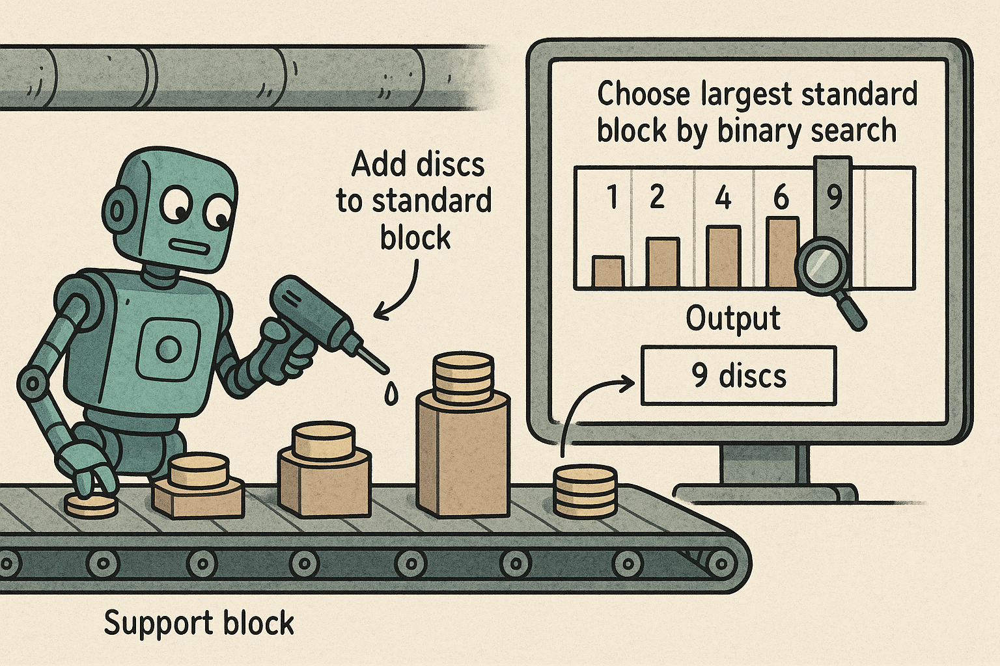

# Algoritmiek: Binary search

**Binary search: schijven tellen**  
*Invoer: schijven.in*  
*Toelichting invoer: schijven.in.readme.txt*  
*Programma: schijven.py*  

Een robot wordt ingezet om in een fabriek steunblokken te produceren die door klanten besteld worden. Elk bestelde steunblok heeft een bepaalde hoogte, die wordt bereikt door een zo groot mogelijk standaardblok te kiezen en daarop schijven te lijmen. Er is een gesorteerde catalogus met daarin de formaten van de standaardblokken beschikbaar. Het juiste standaardblok moet gevonden worden met binary search. Daarna moet er nog bepaald worden hoeveel schijven er op dit zo groot mogelijke standaardblok gelijmd moeten worden.
De output is het totaal aantal schijven wat er nodig was voor al de bestellingen tezamen.


```bash

